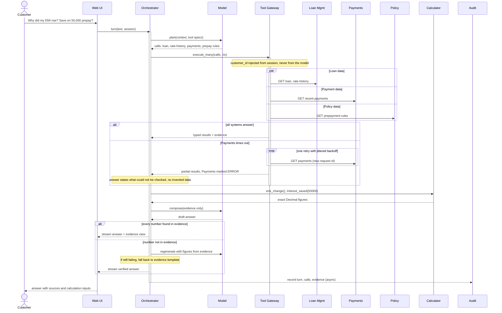
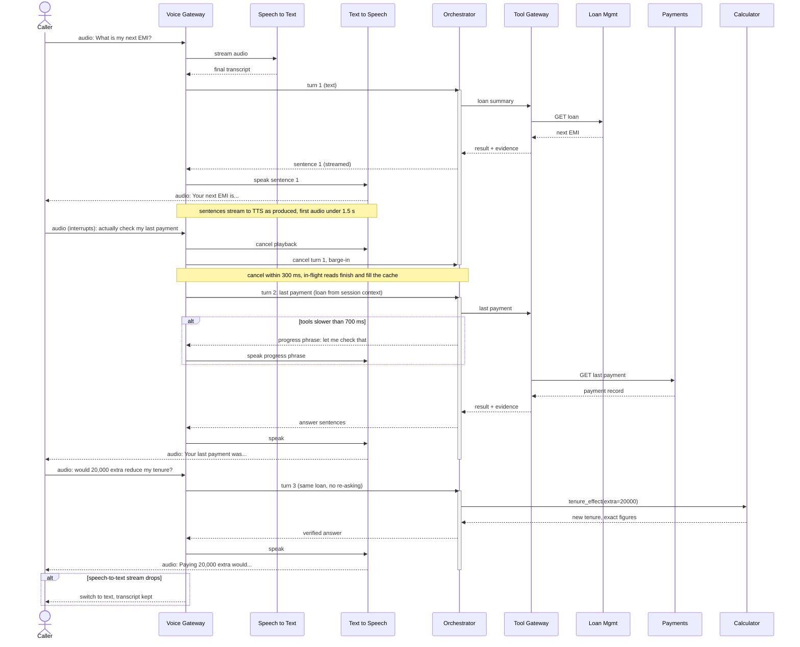
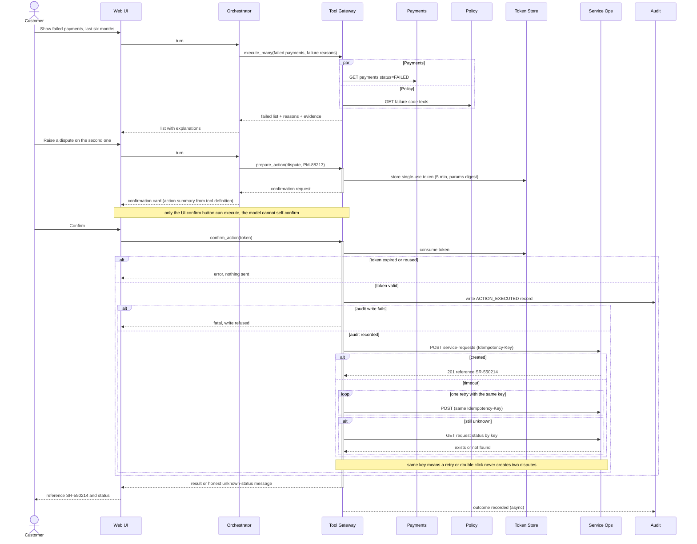

# Sequence Diagrams: Journeys J1 to J3

Mermaid syntax validated. `-->>` is used for returns and for async fire-and-forget (notes mark the async audit lines).

## J1: Explain the EMI rise and simulate a prepayment (text)

## J2: Voice with an interruption and a topic change

## J3: Investigate failed payments, then raise a dispute

## Summary

J1 fans out three reads in parallel, computes figures in the calculator, and checks every number against the evidence before answering. J2 shows the same orchestrator behind voice, with barge-in cancelling speech, kept context across turns, and a progress phrase when tools are slow. J3 separates investigating from acting: the model can only prepare an action, and the customer's confirmation, a single-use token and an idempotency key govern the write.

## Key design decisions

- **Parallel reads:** latency is the slowest system, not the sum, which keeps J1 within the response targets.
- **Partial results are honest:** a failed system is reported as unavailable, never filled in.
- **Verify before sending:** numbers in a draft must exist in the evidence, otherwise regenerate or use the evidence template.
- **Barge-in cancels only the output:** in-flight reads finish and warm the cache, so the next turn is faster.
- **Confirmation is out of the model's hands:** the UI confirm triggers the write, so a prompt injection cannot execute an action.
- **Audit before write:** if the audit record can't be written, the write is refused.
- **Write timeout means "unknown," not "failed":** retry with the same key, then check status before telling the customer anything.

*Payloads and phrases (for example the progress phrase text and PM-88213) are illustrative.*
